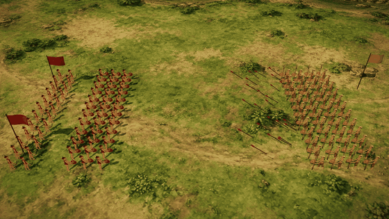

# hyperframes-film-studio

A code-first studio for **faceless YouTube history films in a paper cut-out style**. You write the narration, and the
studio does the rest:

- draws a reusable library of paper puppets, backdrops and props with an image model;
- records the narration with a local text-to-speech voice (Vietnamese or English);
- animates the scenes in HTML and renders them to MP4 with [HyperFrames](https://github.com/heygen-com/hyperframes);
- makes thumbnails and Shorts;
- uploads the result to YouTube or a Facebook page, always as private first.

It is built to be driven by a coding agent such as Claude Code: every step is a script with a `--help`, and the docs say
which file to read for which job.

> This project is independent and is not affiliated with or endorsed by HeyGen. It uses HyperFrames as its renderer.



*The bundled `samples/battle-paper` clip, rendered with `npx hyperframes render`.*

## What's in the box

| Path | What it does |
|---|---|
| `templates/film/` | The film engine: paper-puppet rig, cinematic layer (`fx.js`: colour grades, particles, fog, light rays, camera shake, layered close-up tableaux), map scenes and transitions. Copy it for each new film. |
| `templates/film/examples/` | A sample chapter ("The Ides of March") with every effect, built from the starter assets in `library/`. |
| `templates/battle/`, `templates/short/` | Templates for battle maps (`tools/battle.py`) and vertical Shorts with burned-in captions. |
| `library/` | Starter asset library: four costume kits, two sets of faces, a cut-out, props and four backdrops, plus `catalog.json` and the house style prompt. |
| `tools/` | Python tools: draw and cut assets (`asset.py`), whole-body animation frames (`anim_frames.py`), close-up tableaux (`tableau.py`), narration TTS (`tts_vieneu.py`), frame checks, thumbnails, archive. |
| `publish/` | Node scripts for YouTube (upload, thumbnail, captions, localisations, analytics, retention) and Facebook pages. |
| `samples/battle-paper/` | A small HyperFrames composition that renders on its own. |
| `docs/` | `setup.md` (machine setup), `quy-trinh.md` (the full film workflow, in Vietnamese). |

## Quick start

Requirements: Node.js 18+, Python 3.9+, `ffmpeg` and `ffprobe` on the PATH.

```bash
git clone https://github.com/leminhnhutphpwp/hyperframes-film-studio.git
cd hyperframes-film-studio

# Render the sample clip
cd samples/battle-paper && npx --yes hyperframes@0.8.152 render && cd ../..

# Python tools
python3 -m venv .venv && .venv/bin/pip install playwright imageio-ffmpeg numpy pillow scipy

cp .env.example .env
```

Then pick how the studio draws pictures:

| Backend | Setup | Good for |
|---|---|---|
| **Codex CLI** (`IMAGE_BACKEND=codex`) | Install the [Codex CLI](https://github.com/openai/codex) and sign in once with `codex login`. No API key needed. | Drawing on your own machine with your existing account. |
| **Images API** (`IMAGE_BACKEND=api`) | Set `IMAGE_API_KEY` in `.env`. Change `IMAGE_API_URL` and `IMAGE_MODEL` to use any other OpenAI-compatible provider. | Batch drawing, servers and CI. |

Leave `IMAGE_BACKEND` empty and the studio picks for you: the API when a key is set, otherwise Codex if it's installed.

Draw a new asset, then look it up:

```bash
.venv/bin/python -I tools/asset.py draw kit roman-legionary --era co-dai --region dia-trung-hai --role bo-binh-nang \
  --desc "Roman legionary, tunic, segmented armour, rectangular shield, short sword"
.venv/bin/python -I tools/asset.py list --kind kit
```

Era, region and role codes are listed in [`library/eras.md`](library/eras.md) (for example `co-dai` = ancient,
`dia-trung-hai` = classical Mediterranean, `bo-binh-nang` = heavy infantry).

Text-to-speech, YouTube sign-in and the rest of the setup are in [`docs/setup.md`](docs/setup.md).

## Making a film

1. Create a channel: copy `channels/my-channel/` to `channels/<your-channel>/` and fill in `channel.js`.
2. Start a film: `mkdir -p projects/<channel>/<film> && cp -r templates/film/shared projects/<channel>/<film>/shared`.
3. Write `source/facts.md` (one source per fact) and the narration, record it with `tools/tts_vieneu.py`, then build each
   chapter with `shared/chapter_build.py` and render with HyperFrames.
4. Check the frames (`tools/framecheck.py`), make a thumbnail (`tools/thumb_art.py`, `tools/thumbnail.py`) and upload
   with `publish/youtube/upload.js`. Uploads are private until you change them.

The full workflow, including how to keep each film different enough for YouTube's "inauthentic content" policy, is in
[`docs/quy-trinh.md`](docs/quy-trinh.md).

## Good to know

- **Images:** every drawing tool goes through `tools/imagegen.py`, using either the Codex CLI on your machine or an
  OpenAI-compatible Images API. Use an account and a model whose terms allow your use.
- **Voices:** Vietnamese uses VieNeu-TTS and English uses Kokoro. Both run locally; models download on first use.
- **Secrets:** `.env` and `secrets/` are git-ignored. Never commit API keys or OAuth tokens.
- **Music and sound:** only add audio you have the right to use, and keep its source and licence next to it.

## Licence

Code and the starter assets: [MIT](LICENSE). The bundled Lora font is under the SIL Open Font License 1.1.
HyperFrames is a separate project with its own licence.

---

## Tiếng Việt

Studio làm phim lịch sử dạng rối giấy cho kênh YouTube không lộ mặt, viết bằng code. Bạn viết lời kể, studio lo phần
còn lại: vẽ thư viện nhân vật và phông bằng mô hình ảnh, đọc lời kể bằng giọng máy chạy trong máy (tiếng Việt hoặc
tiếng Anh), dựng cảnh bằng HTML rồi render ra MP4 bằng HyperFrames, làm thumbnail và Shorts, và đăng lên YouTube ở
chế độ riêng tư.

Để vẽ hình, bạn dùng một trong hai cách: cài Codex CLI trên máy và đăng nhập (`codex login`, không cần khoá API),
hoặc điền khoá của một dịch vụ Images API tương thích OpenAI vào `.env`.

Bắt đầu từ phần **Quick start** ở trên. Quy trình làm một phim đầy đủ nằm ở [`docs/quy-trinh.md`](docs/quy-trinh.md).
