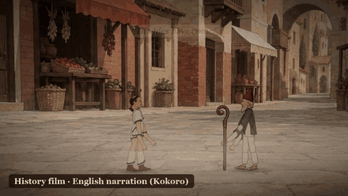
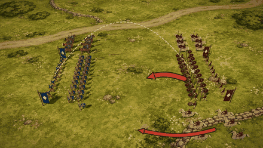
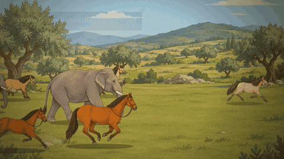
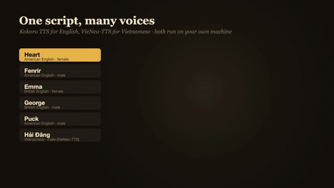

# hyperframes-film-studio

A code-first studio for **faceless YouTube videos**: paper cut-out history films, battles, animals, stick-figure
animation, vertical Shorts and data explainers. You write the narration, and the studio does the rest:

- draws a reusable library of paper puppets, backdrops and props with an image model;
- records the narration with a local text-to-speech voice (Vietnamese or English);
- animates the scenes in HTML and renders them to MP4 with [HyperFrames](https://github.com/heygen-com/hyperframes);
- makes thumbnails and Shorts;
- uploads the result to YouTube or a Facebook page, always as private first.

It is built to be driven by a coding agent such as Claude Code or Codex: every step is a script with a `--help`, and
[`AGENTS.md`](AGENTS.md) tells the agent where things are and which commands work. A complete example film builds and
renders with one command.

> This project is independent and is not affiliated with or endorsed by HeyGen. It uses HyperFrames as its renderer.

## Demos

Every clip below was rendered from this repository with `npx hyperframes render`, sound included: narration from local
TTS, music and effects generated in code.
▶ **[Watch the demo reel with sound (68 s)](https://github.com/leminhnhutphpwp/hyperframes-film-studio/releases/download/v0.3.0/demo-reel.mp4)**

<table>
  <tr>
    <td width="50%"><br /><b>History film</b>: paper puppets, fog, colour grades and a layered painted close-up, narrated in English (<code>examples/ides-of-march</code>)</td>
    <td width="50%"><br /><b>Battle map</b>: hundreds of puppets, flanking arrows, a moving camera (<code>tools/battle.py</code>)</td>
  </tr>
  <tr>
    <td><br /><b>Animals</b>: drawn once, played as whole-body walk and gallop cycles (<code>demos/animals</code>)</td>
    <td><br /><b>Stick figures</b>: every pose is code, no image assets (<code>demos/stickman</code>)</td>
  </tr>
  <tr>
    <td><br /><b>Explainer</b>: typed headline, growing bars, counting numbers (<code>demos/explainer</code>)</td>
    <td align="center"><br /><b>Daily-life Short</b>: 9:16, narrated, captions that follow the voice word by word (<code>demos/daily-life</code>)</td>
  </tr>
  <tr>
    <td colspan="2"><br /><b>Voices</b>: five English voices (Kokoro) and a Vietnamese one (VieNeu), all running locally (<code>demos/voices</code>)</td>
  </tr>
</table>

## What's in the box

| Path | What it does |
|---|---|
| `examples/ides-of-march/` | A complete film project (narration, chapter, tableaux, narration audio) that builds and renders with `build.sh`. Copy it to start a film. |
| `templates/film/` | The film engine: paper-puppet rig, cinematic layer (`fx.js`: colour grades, particles, fog, light rays, camera shake, layered close-up tableaux), map scenes and transitions. |
| `templates/battle/`, `templates/short/` | Templates for battle maps (`tools/battle.py`) and vertical Shorts with burned-in captions. |
| `library/` | Starter asset library: four costume kits, two sets of faces, a cut-out, props and four backdrops, plus `catalog.json` and the house style prompt. |
| `tools/` | Python tools: draw and cut assets (`asset.py`), whole-body animation frames (`anim_frames.py`), close-up tableaux (`tableau.py`), narration TTS (`tts_vieneu.py`), frame checks, thumbnails, archive. |
| `publish/` | Node scripts for YouTube (upload, thumbnail, captions, localisations, analytics, retention) and Facebook pages. |
| `demos/` | Short standalone compositions with sound: voices, animals, stick figures, a vertical daily-life Short, a data explainer. |
| `samples/battle-paper/` | A small HyperFrames composition that renders on its own. |
| `docs/` | `setup.md` (machine setup), `workflow.md` (the full film workflow). |
| `AGENTS.md` | The guide for coding agents: setup, a map of the repo, common tasks, rules that keep builds working. |

## Quick start

Requirements: Node.js 18+, Python 3.9+, `ffmpeg` and `ffprobe` on the PATH. For the English voice, also
[uv](https://docs.astral.sh/uv/) or Python 3.12.

```bash
git clone https://github.com/leminhnhutphpwp/hyperframes-film-studio.git
cd hyperframes-film-studio

bash scripts/setup.sh --kokoro           # Python tools, .env, the English voice and its model (~350 MB)
bash examples/ides-of-march/build.sh     # builds and renders the example film (~4 min) → examples/ides-of-march/ch01/renders/
```

Using a coding agent? Point it at [`AGENTS.md`](AGENTS.md) and ask it to run the two commands above first.

Then pick how the studio draws pictures:

| Backend | Setup | Good for |
|---|---|---|
| **Codex CLI** (`IMAGE_BACKEND=codex`) | Install the [Codex CLI](https://github.com/openai/codex) and sign in once with `codex login`. No API key needed. | Drawing on your own machine with your existing account. |
| **Images API** (`IMAGE_BACKEND=api`) | Set `IMAGE_API_KEY` in `.env`. Change `IMAGE_API_URL` and `IMAGE_MODEL` to use any other OpenAI-compatible provider. | Batch drawing, servers and CI. |

Leave `IMAGE_BACKEND` empty and the studio picks for you: the API when a key is set, otherwise Codex if it's installed.

Draw a new asset, then look it up:

```bash
.venv/bin/python -I tools/asset.py draw kit roman-legionary --era ancient --region mediterranean --role heavy-infantry \
  --desc "Roman legionary, tunic, segmented armour, rectangular shield, short sword"
.venv/bin/python -I tools/asset.py list --kind kit
```

Era, region and role codes are listed in [`library/eras.md`](library/eras.md).

Vietnamese TTS, YouTube sign-in and the rest of the setup are in [`docs/setup.md`](docs/setup.md).

## Making a film

1. Copy the example: `cp -r examples/ides-of-march projects/<channel>/<film>`.
2. Write `narration.en.txt` (one `NNN text` line per sentence, `# ── Title` for each chapter) and `source/facts.md`
   (one source per fact). Edit `ch01/chapter.json` (which assets and backdrops the chapter uses) and `ch01/js/scenes.js`
   (what happens on screen, timed to the narration lines). Add `ch02/`, `ch03/` … for more chapters.
3. Build and render: `bash projects/<channel>/<film>/build.sh --voice` (records the narration, then renders every chapter).
4. Check the frames (`tools/framecheck.py`), make a thumbnail (`tools/thumb_art.py`, `tools/thumbnail.py`), fill in
   `channels/<channel>/channel.js` and upload with `publish/youtube/upload.js`. Uploads are private until you change them.

The full workflow, including how to keep each film different enough for YouTube's "inauthentic content" policy, is in
[`docs/workflow.md`](docs/workflow.md).

## Good to know

- **Images:** every drawing tool goes through `tools/imagegen.py`, using either the Codex CLI on your machine or an
  OpenAI-compatible Images API. Use an account and a model whose terms allow your use.
- **Voices:** English uses Kokoro (54 voices; `scripts/setup.sh --kokoro`), Vietnamese uses VieNeu-TTS (`docs/setup.md`).
  Both run locally.
- **Music and effects in code:** `tools/synth_audio.py` makes music beds (lyre, oud, zither, tanpura) and battle sounds
  (melee, muskets, cannon) from numpy, so there is nothing to license. `demos/make_audio.py` shows how the demos use it.
- **Secrets:** `.env` and `secrets/` are git-ignored. Never commit API keys or OAuth tokens.
- **Music and sound:** only add audio you have the right to use, and keep its source and licence next to it.

## Licence

Code and the starter assets: [MIT](LICENSE). The bundled Lora font is under the SIL Open Font License 1.1.
HyperFrames is a separate project with its own licence.
